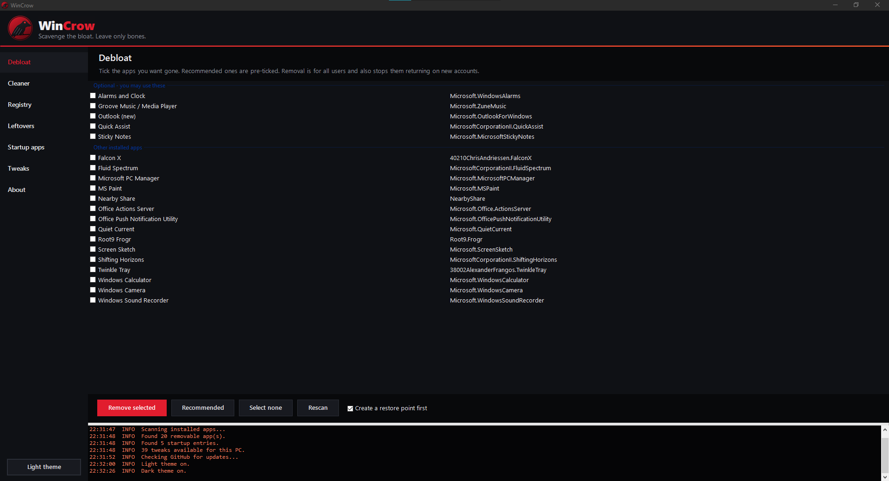
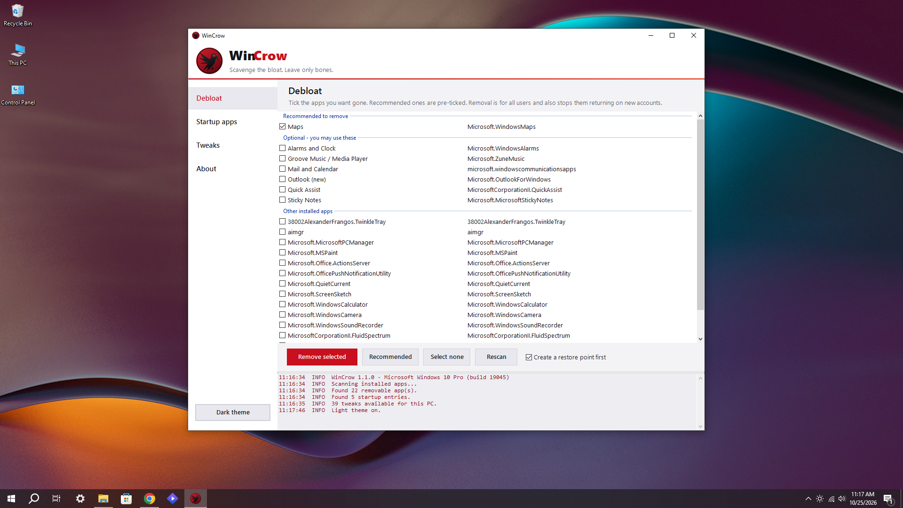

# WinCrow

**Scavenge the bloat. Leave only bones.**

WinCrow is a single-file PowerShell tool with a dark-or-light GUI that strips Windows 10 and Windows 11 down to what you actually use. It removes bloated apps, cleans junk files, clears registry clutter, finds leftovers from programs you removed, controls what starts with Windows, and flips 43 privacy, performance and interface switches. It also checks GitHub for new versions and can update itself.


---



---



---

## Features

- **Debloat** - lists the Store apps on your PC, pre-ticks the junk (Candy Crush, TikTok, Bing apps, Solitaire, Clipchamp, trial software and more) and removes what you pick. Removal is for all users and also stops the apps returning on new accounts.
- **Cleaner** - 33 CCleaner-style cleaning options in five groups: Windows, Browsers, Applications, Privacy traces and Advanced. Press **Analyze** to see how much each one holds, tick what you want, press **Clean selected**.
- **Registry** - finds broken and obsolete registry entries. A `.reg` backup of every key is saved before anything is changed, so every fix can be undone.
- **Leftovers** - finds broken shortcuts, empty folders and Program Files folders that no installed program uses any more.
- **Startup apps** - shows everything that starts with Windows (registry Run keys and Startup folders). Untick to stop, tick to bring it back. Nothing is deleted.
- **Tweaks** - 43 reversible switches in five groups: Privacy, Ads and bloat, Performance, Interface, System. Includes "Disable background apps".
- **Updates** - reads `version.txt` on GitHub when WinCrow starts (you can turn this off). Same version: nothing happens. Newer version: one click installs it.
- **Dark and light themes** - one click in the sidebar; your choice is remembered.
- **Installs like a real program** - first launch copies WinCrow to `C:\Program Files\WinCrow` and adds a Start menu shortcut.

## Install

### Option 1: the installer (recommended)

1. Download this repository (**Code > Download ZIP**) and extract the whole folder.
2. Double-click **`WinCrow Installer.cmd`** and accept the administrator prompt.
3. Choose **1) Install or update WinCrow**.

WinCrow opens and is now in your Start menu as **WinCrow**.

### Option 2: run the script directly

Open PowerShell in the extracted folder and run:

```powershell
powershell -ExecutionPolicy Bypass -File .\WinCrow.ps1
```

On first launch WinCrow installs itself the same way as the installer does.

## Using WinCrow

| Page | What to do |
| --- | --- |
| **Debloat** | Tick the apps to remove (recommended ones are pre-ticked), keep *Create a restore point first* on, press **Remove selected**. |
| **Cleaner** | Press **Analyze** to measure, tick what to clean, press **Clean selected**. Close your browsers first. |
| **Registry** | Press **Scan for issues**, review the list, press **Fix selected**. |
| **Leftovers** | Press **Scan**, review the list, press **Remove selected**. |
| **Startup apps** | Untick anything you do not want at sign-in, press **Apply changes**. Takes effect at the next sign-in. |
| **Tweaks** | Tick a tweak to apply it, untick to restore the Windows default, press **Apply changes**. File Explorer restarts automatically when a tweak needs it. |
| **About** | Version, developer, **Check for updates** and the log folder. |

The sidebar button at the bottom switches between the dark and light theme. When a newer version exists, an **Update** button appears above it.

## The Cleaner

Items marked *off* are not ticked by default because they cost you something (history, speed or troubleshooting data). Browser cleaning touches **caches only**: your passwords, history, cookies and bookmarks are never touched. Cleaned files are deleted, not sent to the Recycle Bin.

| Group | Items |
| --- | --- |
| **Windows (12)** | User temporary files, Windows temporary files, Recycle Bin *(off)*, Thumbnail cache, Internet cache (legacy), Windows Update download cache, Delivery Optimization cache, Windows error reports, Memory dump files, Windows log files, App crash dumps, DNS cache |
| **Browsers (6)** | Google Chrome, Microsoft Edge, Mozilla Firefox, Brave, Opera and Vivaldi caches |
| **Applications (8)** | Discord, Spotify, Slack, Microsoft Teams (classic) and Visual Studio Code caches, Steam web cache, GPU shader caches *(off)*, Developer caches: npm, pip, NuGet *(off)* |
| **Privacy traces (4)** | Recent files and jump lists, Run dialog history, Explorer address bar history, Explorer search history *(all off)* |
| **Advanced (3)** | Prefetch files, Windows event logs (all except Security), Component store cleanup via DISM *(all off)* |

Files that are in use are skipped, not forced. Folders such as `System32`, `SysWOW64` and `WinSxS` can never be targeted by a file-cleaning item.

## The Registry cleaner

WinCrow looks for seven kinds of clutter, and only reports an entry when it is sure the file is gone (on a fixed drive that is present; network paths and unplugged drives are never flagged):

- Missing shared DLLs
- Obsolete application paths (App Paths)
- Broken uninstall entries (the uninstaller and the install folder are both gone)
- Startup entries that point to missing programs
- Stale MUI cache entries
- Obsolete compatibility entries
- Missing Windows Installer folder records

Everything found is ticked, but nothing changes until you press **Fix selected**. Before any change WinCrow exports each affected key to `C:\ProgramData\WinCrow\RegBackups\<date-time>\` (with an `index.txt`), and if the backup of a key fails, that entry is left alone. To undo a fix, open **Backups folder** and double-click the matching `.reg` file. An optional restore point is created as well.

## Leftovers

- **Broken shortcuts** in the Start menu and on the Desktop whose target no longer exists.
- **Empty folders** in Program Files, ProgramData and AppData that have not changed in 30 days.
- **Program folders with no matching program** in Program Files. A folder is only listed when no installed program, service, running process, startup item, scheduled task or working shortcut refers to it. These are **not ticked by default**, and removing one **moves it to quarantine** (`C:\ProgramData\WinCrow\Quarantine`) instead of deleting it. Open **Quarantine** to put a folder back, or press **Empty it** when you are sure.

Common system and vendor folders (Microsoft, Windows, Common Files, NVIDIA, Intel, Adobe, Google and others) are never listed.

## Updates

WinCrow reads the tiny file `version.txt` from the `main` branch of [tasmon/WinCrow](https://github.com/tasmon/WinCrow) and compares it with the version you run.

- **Same version (or older):** nothing is downloaded and nothing happens.
- **Newer version:** an **Update** button appears in the sidebar and **About** shows the new version. When you accept, WinCrow downloads `WinCrow.ps1` from `main`, checks that it is a valid WinCrow script with a higher version number, keeps your current script as `WinCrow.ps1.bak`, installs the new one and restarts. If any check fails, nothing is changed.

The startup check runs in the background and never delays the window. Turn it off in **About > Check for updates when WinCrow starts**. You can also press **Check for updates** at any time.

## The tweaks

**Privacy (13)** - Disable background apps, Reduce telemetry, Turn off advertising ID, Disable activity history, Disable Windows Error Reporting, Opt out of the Customer Experience Program, Stop app-launch tracking, Turn off tailored experiences, Disable feedback prompts, Hide language list from websites, Turn off online speech recognition, Disable location services, Disable Recall (Windows 11).

**Ads and bloat (6)** - Remove tips, suggestions and silent app installs, Block consumer features, No web results in Start search, Disable Widgets / News and Interests, Disable Copilot, Disable Cortana (Windows 10).

**Performance (9)** - Disable Game Bar / Game DVR, Stop Edge startup boost and background mode, Disable Delivery Optimization peer-to-peer, Disable SysMain (Superfetch), Faster shutdown, Faster menu animations, Remove desktop startup delay, Disable Fast Startup, Turn off transparency effects.

**Interface (11)** - Show file extensions, Show hidden files and folders, Open File Explorer to This PC, Hide Recent and Frequent in Quick access, Use dark mode for Windows and apps, Classic right-click menu (Windows 11), Left-align the taskbar (Windows 11), Hide the Chat button (Windows 11), Hide the Task View button, Hide the taskbar search box, Disable the Sticky Keys popup.

**System (4)** - No auto-restart while you are signed in, Keep drivers out of Windows Update, Disable Remote Assistance, Disable OneDrive file sync.

Tweaks that only apply to one Windows version are hidden on the other.

## Safety and undo

- **Tweaks and startup apps** are fully reversible: untick and apply.
- **Registry fixes** are backed up to `.reg` files first and can be restored with a double-click.
- **Leftover program folders** go to quarantine, not straight to deletion.
- **Removed apps** can be reinstalled from the Microsoft Store.
- **Cleaned files** (caches, temp files, logs) are deleted for good. They are regenerated by Windows and your apps, but review the ticked items first.
- WinCrow can create a **System Restore point** before removing apps or fixing the registry. If System Protection is off, or a point was made in the last 24 hours, Windows may skip it; WinCrow logs that and carries on.
- Windows, the Store, codecs, the Edge runtime and graphics-driver apps are protected and never listed for removal.
- Read the tick list before pressing a button. *Optional* apps (Phone Link, Mail and Calendar, Xbox, Sticky Notes and similar) are un-ticked on purpose.
- Some tweaks are policy settings. A major Windows feature update can reset them; open WinCrow and re-apply.
- Tweaks that write to your user settings apply to the account running WinCrow. If you elevate with a different admin account, run WinCrow from your own account instead.

## Uninstall

Remove WinCrow like any other program: **Settings > Apps > Installed apps > WinCrow > Uninstall** (or Control Panel > Programs and Features). You can also run **`WinCrow Installer.cmd`** and choose **2**, or `.\WinCrow.ps1 -Uninstall`. This removes the program folder, the Start menu shortcut and the Installed apps entry. It does not change your Windows settings, and it keeps `C:\ProgramData\WinCrow` (registry backups and quarantine) so you can still undo earlier clean-ups. Delete that folder yourself when you no longer need it. Untick your tweaks first if you want them reverted.

## Requirements

- Windows 10 (1809 or newer) or Windows 11
- Windows PowerShell 5.1, which ships with Windows
- Administrator rights
- Internet access only for the update check

## Troubleshooting

**Windows says the script is blocked, or SmartScreen warns.** The script is unsigned. Use the installer, which unblocks it, or run `Unblock-File .\WinCrow.ps1` once. Read the script first if you like; it is a single readable file.

**Antivirus flags it.** Tools that edit policies, clean the registry and remove apps can look suspicious to heuristics. The full source is in `WinCrow.ps1`.

**An app fails to remove, or a cache is not cleaned.** The log panel and `C:\Program Files\WinCrow\Logs` show why. Close the app (browsers especially) and try again.

**"No version.txt was found on GitHub yet."** The project has no `version.txt` in its main branch. Maintainers: see below.

**A tweak looks un-ticked after a restart.** Windows or an update reset it. Re-apply it.

**Logs** are in `C:\Program Files\WinCrow\Logs`. Your theme and update settings are in `settings.json` in the same folder.

## Project layout

```
WinCrow/
  WinCrow.ps1               the whole app (GUI, installer logic, cleaner, debloat list, tweaks)
  WinCrow Installer.cmd     one-click installer / uninstaller
  version.txt               the latest version number, read by the in-app update check
  README.md
  LICENSE
  .gitattributes
```

## Contributing

Pull requests are welcome.

- **Add an app to the debloat list:** add a line to `$RuleText` in `WinCrow.ps1` in the form `package-name-pattern|Friendly name|R` (`R` = recommended, `O` = optional). Wildcards (`*`) are allowed.
- **Add a tweak:** add an `Add-Tw` call in the tweak section. Use `Rg` for each registry value and give a restore value (or `$null` to delete the value on restore). Mark version-specific tweaks with `-Only10` or `-Only11`, and add `-Restart` if File Explorer must restart.
- **Add a cleaner item:** add an `Add-Cl` call in the cleaner section, for example `Add-Cl 'Applications' 'My app cache' 'What it holds' @("$LA\MyApp\Cache\*")`. Paths need wildcards or a folder with `\*` at the end, must be at least two levels deep, and can never point into `System32`, `SysWOW64` or `WinSxS`. Add `-On $false` if it should not be ticked by default.
- Keep the file **ASCII only** so Windows PowerShell 5.1 reads it correctly, and test on both a Windows 10 and a Windows 11 machine or VM.

## Publishing an update (maintainers)

The in-app updater compares `version.txt` with the version inside the script. To ship a new version:

1. Change `$AppVersion` in `WinCrow.ps1` (for example `'1.3.0'`).
2. Put the same number in `version.txt` (one line, for example `1.3.0`).
3. Commit both files to `main`.

Users on an older version see the **Update** button the next time they open WinCrow. Upload `WinCrow.ps1` first and `version.txt` last, so nobody is offered a version that is not there yet. If `version.txt` is higher than the script on `main`, WinCrow refuses the update and changes nothing.

## Disclaimer

WinCrow changes system settings, deletes files and edits the registry. It is provided as is, without warranty. Create a backup or restore point, review what is ticked, and use it at your own risk.

## License

MIT - see [LICENSE](LICENSE).

## Developer

**Tasmon Islam** - [tasmon@outlook.com](mailto:tasmon@outlook.com)
